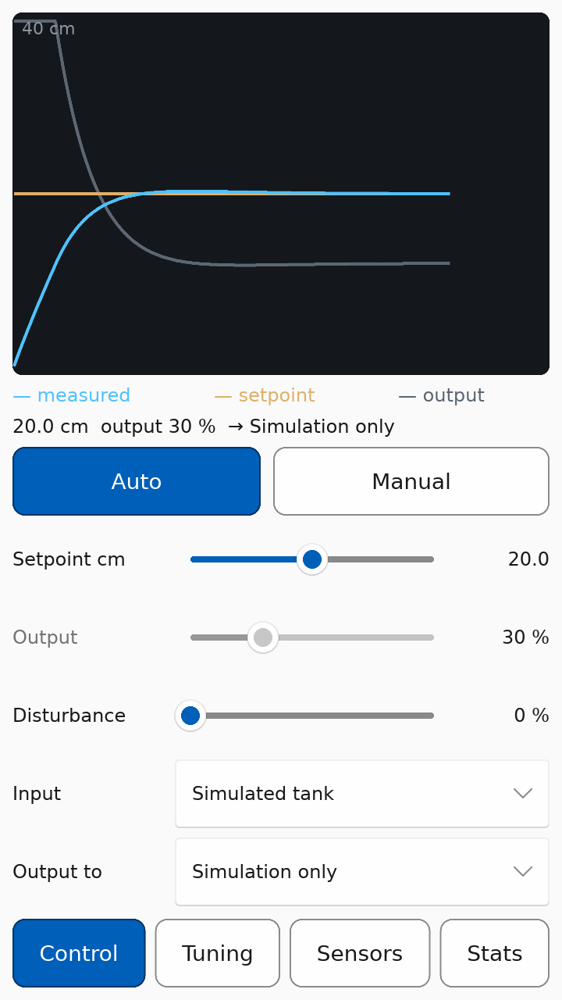
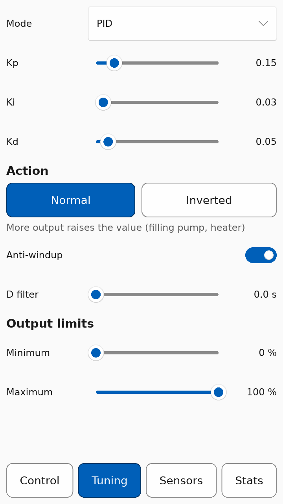
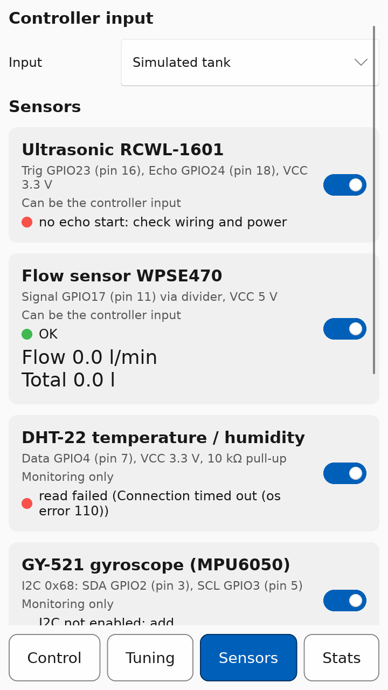
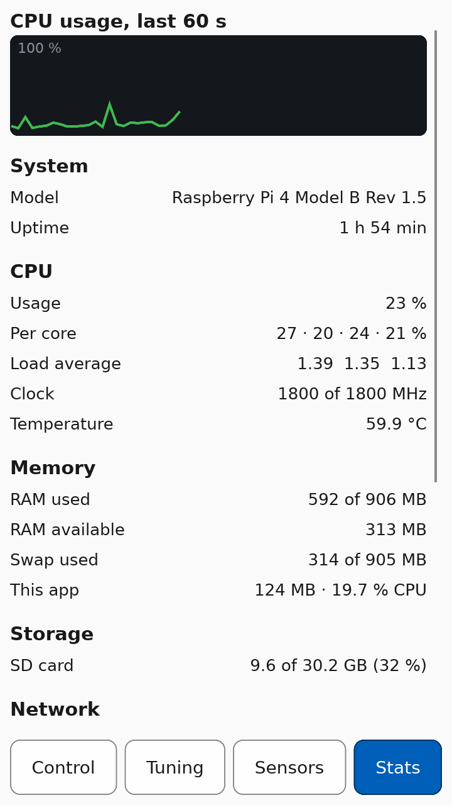
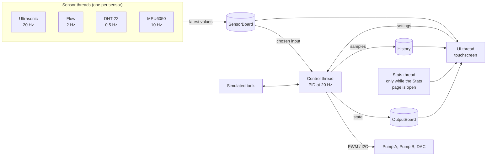

# pid-rust-demo

A PID controller for a **Raspberry Pi 4 with the Touch Display 2**, written in Rust. It started as a small project for
learning the language and now runs the real touchscreen:

- a PID controller (P, PI, PD, PID) against a simulated water tank, or against real sensors;
- drivers for every sensor and output on the parts list;
- a touchscreen UI with four pages: **Control**, **Tuning**, **Sensors** and **Stats**.

<p align="center">
  
  
  
  
</p>

Every file is heavily commented. The comments explain what the code does and why it is written that way, with C++
comparisons where useful, so the project can be read as a Rust course.

## Documentation

| Document | Contents |
|---|---|
| [`docs/PROJECT-NOTES.md`](docs/PROJECT-NOTES.md) | Goals, decisions, architecture, library choices, status, open questions |
| [`docs/IO-MAP.md`](docs/IO-MAP.md) | Every sensor and output: pins, wiring diagram, voltage cautions, role in the controller |
| [`docs/PI-SETUP.md`](docs/PI-SETUP.md) | Setting up the Pi: display, build, start at boot, troubleshooting, resource use |

## How it fits together



Every arrow between threads goes through a value protected by a lock (`Arc<Mutex<...>>`). The control loop never waits
for drawing, and only the UI thread touches the screen.

## The pages

| Page | What it does |
|---|---|
| **Control** | Live plot of measured value, setpoint and output. Auto/manual (bumpless), setpoint (scaled to the chosen input), output by hand, disturbance, and the choice of input (simulated tank, ultrasonic level, flow) and output (simulation only, pump A, DAC) |
| **Tuning** | Mode, gains, normal or inverted action, anti-windup on/off, derivative filter, output limits |
| **Sensors** | One card per sensor and output: wiring, status, live values, on/off switch for sensors |
| **Stats** | CPU (with a 60 s graph), memory, SD card, Ethernet/Wi-Fi, and power: under-voltage, throttling, core voltage, supply limits. It samples once a second, **only while the page is open** |

Safety: in auto, losing the input sets the output to 0 % and the plot shows a gap. Real outputs start and end at 0 %.
The e-stop must still cut pump power in hardware.

## Running on a PC (Mac, Windows, Linux)

The UI runs in a normal window at the panel's size, with the simulated tank. Real sensors show as unavailable.

1. Install Rust (this also installs Cargo, the build tool and package manager):
   - Mac and Linux: `curl --proto '=https' --tlsv1.2 -sSf https://sh.rustup.rs | sh`
   - Windows: run `rustup-init.exe` from [rustup.rs](https://rustup.rs). It also offers to install the Visual
     Studio C++ build tools, which Rust needs on Windows.
2. Open a new terminal and check it worked: `cargo --version`.
3. Run:

   ```sh
   cargo run --bin ui   # touchscreen UI in a window
   cargo run            # terminal demo, PID mode (default)
   cargo run -- p       # terminal demo, proportional only (also: pi, pd)
   cargo test           # unit tests
   ```

The first build compiles the UI toolkit (Slint), which takes a few minutes. Later builds take seconds. On Linux the
window also needs `libfontconfig-dev`.

For editing, VS Code with the `rust-analyzer` extension gives inline types and errors as you type. The Slint extension
previews the UI markup.

## Running on the Raspberry Pi

```sh
cargo build --release --features kms -j1
sudo systemctl restart pid-ui
```

`--features kms` adds the backend that draws on the touchscreen without a desktop. `-j1` avoids running out of memory
on the 1 GB Pi. First-time setup (display, libraries, boot service) is in [`docs/PI-SETUP.md`](docs/PI-SETUP.md).

## Things to try

With the simulated tank on the Control page:

- **Mode `P`** (Tuning page): the level stops short of the setpoint. PI and PID reach it.
- **High `Ki`** (0.3 and up) with low `Kp`: about 2 cm of overshoot and a swing below the setpoint before it settles.
- **Disturbance** at 50 %: the level dips, then the integral term pushes the pump harder and brings it back.
- **Anti-windup off**, then raise the setpoint to 40 cm (the pump saturates) and back to 20 cm: a much bigger
  overshoot than with anti-windup on.
- **Manual**, move the output, then back to **Auto**: the output continues smoothly from where you left it.
- **All gains at zero** in mode `PI` or `PID`: the pump holds its last value, because the integral term remembers what
  it accumulated.

## Reading order

Start at the top. Each file builds on the ones before it.

| File | What it is | Rust ideas it shows |
|---|---|---|
| `src/pid.rs` | The controller maths | structs, enums, `match`, `Option`, methods, unit tests |
| `src/plant.rs` | The simulated tank | traits (interfaces), default methods |
| `src/lib.rs` | What the library contains | modules, sharing code between programs |
| `src/main.rs` | Terminal demo | `Result`, `Box<dyn Trait>`, threads, channels, ownership |
| `src/sensors/mod.rs` | Sensor list and sensor threads | `const` tables, traits, `Arc<Mutex<...>>`, thread loops |
| `src/sensors/dht22.rs` | Reading a kernel driver's files | file I/O, `?` with errors, testing with fake files |
| `src/sensors/ultrasonic.rs` | Timing an echo with GPIO events | external crates, `#[cfg(...)]` for Linux-only code |
| `src/sensors/flow.rs`, `mpu6050.rs` | Pulse counting, an I2C device | integer wrap-around, byte decoding |
| `src/hw/i2c.rs`, `pwm.rs` | Talking to Linux hardware | `unsafe` (one small block), `Drop` as a destructor |
| `src/outputs/` | Pumps and DAC | trait objects, `let ... else`, safe shutdown |
| `src/stats.rs` | System statistics | parsing text, `HashMap`, running helper programs |
| `src/bin/ui.rs` | The touchscreen program | Slint markup, models, timers, closures, thread parking |

## Exercises

Ordered from easy to harder. The compiler's error messages are unusually helpful, so read them fully when something
does not build.

1. Change the gains in `main.rs` until the tank clearly overshoots the setpoint.
2. Read the gains from the command line (`cargo run -- pid 0.2 0.05 0.0`). `"0.2".parse::<f64>()` returns a `Result`.
3. Add a second plant in `plant.rs`, for example a heater with a slow temperature response, and select it with a
   command-line argument. Nothing in `run_control_loop` should need to change.
4. After `thread::spawn` in `main.rs`, try to use `controller` again. Read the error: this is the ownership rule that
   makes threads safe.
5. Add a "Reset gains" button to the Tuning page that restores the starting gains. This touches the markup, a new
   callback and `main` in `src/bin/ui.rs`.
6. Show the DHT-22 temperature in the status line on the Control page. The value is already on the `SensorBoard`.
7. Add the e-stop sense input (GPIO22, see `docs/IO-MAP.md`) as a new sensor in `src/sensors/`. The Sensors page and
   the control loop pick it up from the `SENSORS` list.
