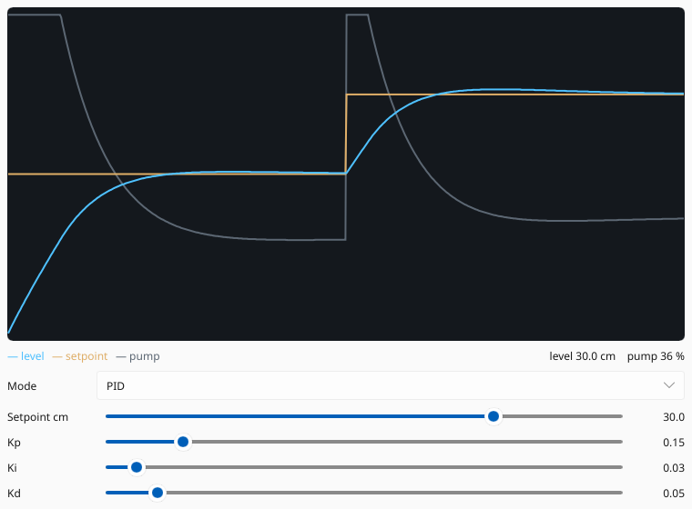

# pid-rust-demo

A small Rust project for getting used to the language before the
Raspberry Pi PID controller project. It runs a PID controller against a
simulated water tank and shows the result two ways: as text in the
terminal, and in a window with a live plot and sliders.



Every file is heavily commented: the comments explain both what the code
does and why it is written that way, with C++ comparisons where useful.

## Setup on a Mac

1. Install Rust (this also installs Cargo, the build tool and package manager):

   ```sh
   curl --proto '=https' --tlsv1.2 -sSf https://sh.rustup.rs | sh
   ```

2. Open a new terminal, then check it worked:

   ```sh
   cargo --version
   ```

For editing, VS Code with the `rust-analyzer` extension gives inline
types and errors as you type.

## Running

```sh
cargo run            # terminal demo, PID mode (default)
cargo run -- p       # terminal demo, proportional only
cargo run -- pi      # terminal demo, proportional + integral
cargo run --bin ui   # window demo
cargo test           # run the unit tests
```

The first build downloads and compiles the UI toolkit (Slint), which
takes a few minutes. Later builds only recompile this project and take
seconds.

### Terminal demo

Each row shows the time, the tank level, a bar (`#` = level, `|` =
setpoint) and the pump power. The setpoint is 20 cm, then 30 cm from
the halfway point.

What to notice: in `p` mode the level settles about 2 cm below the
setpoint and stays there. In `pi` and `pid` mode it reaches the setpoint.

### Window demo

The simulation runs continuously in real time. The plot shows the last
30 seconds. Move the setpoint slider to give the controller a step to
follow, switch the mode, and drag the gains while it runs:

- Mode `P`: the level stops short of the setpoint.
- High `Ki` (0.3 and up) with low `Kp`: about 2 cm of overshoot and a
  swing below the setpoint before it settles.
- All gains at zero in mode `P`: the pump stops and the tank drains.
- All gains at zero in mode `PI` or `PID`: the pump holds its last value,
  because the integral term remembers what it accumulated.

On Linux the window demo also needs the fontconfig development package
(`libfontconfig-dev` on Debian/Ubuntu). macOS needs nothing extra.

## Reading order

| File | What it shows |
|---|---|
| `src/pid.rs` | structs, enums, `match`, `Option`, methods, unit tests |
| `src/plant.rs` | traits (interfaces) and implementing them |
| `src/lib.rs` | how code is shared between two programs |
| `src/main.rs` | `Result`, `Box<dyn Trait>`, threads, channels, ownership |
| `src/bin/ui.rs` | Slint markup, `Arc<Mutex<...>>` shared state, closures, iterators |

## Exercises

Ordered from easy to harder. The compiler's error messages are unusually
helpful, so read them fully when something does not build.

1. Change the gains in `main.rs` until the tank clearly overshoots the
   setpoint.
2. Add a `Pd` variant to `Mode` in `pid.rs`. The compiler will list every
   place that needs updating.
3. Read the gains from the command line (`cargo run -- pid 0.2 0.05 0.0`).
   `"0.2".parse::<f64>()` returns a `Result`.
4. Add a second plant in `plant.rs`, for example a heater with a slow
   temperature response, and select it with a command-line argument.
   Nothing in `run_control_loop` should need to change.
5. After `thread::spawn` in `main.rs`, try to use `controller` again.
   Read the error: this is the ownership rule that makes threads safe.
6. In `src/bin/ui.rs`, add a "Drain" slider that changes how fast the
   tank empties, to act as a disturbance. This touches the markup, the
   `Settings` struct, the callback and the plant.
