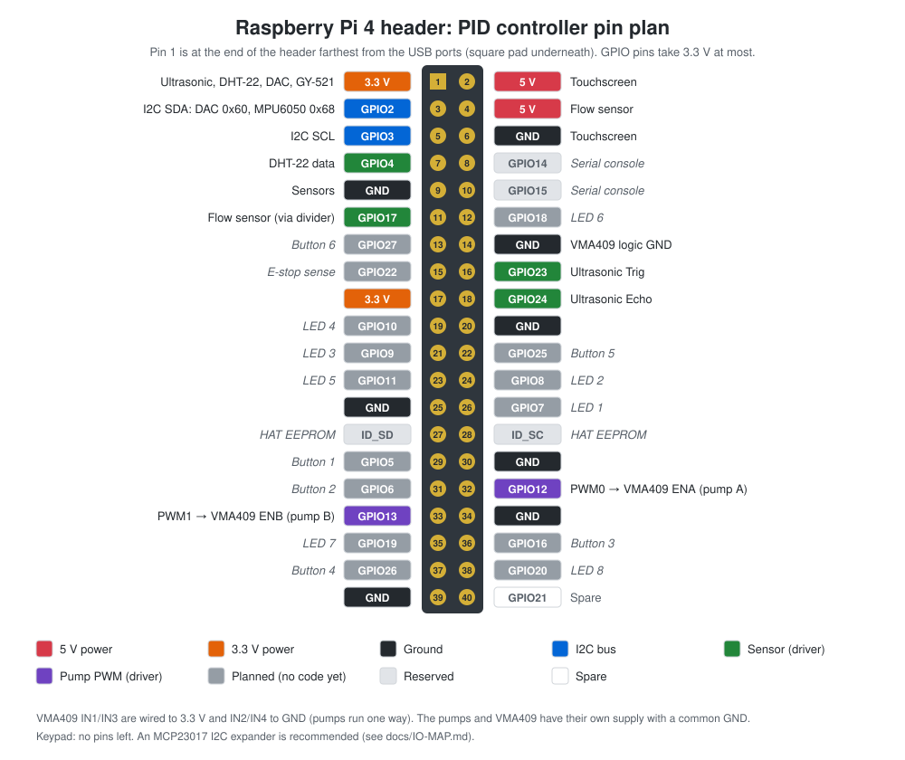
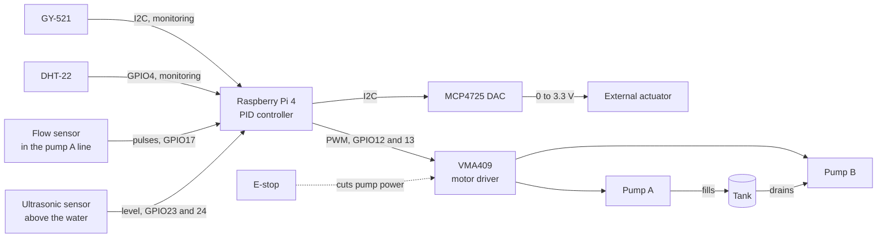

# I/O map: every part, its pins and its role in the PID demo

This covers every input and output on the component list, how each connects to the Raspberry Pi 4, and what it does
for the controller. It complements [`PROJECT-NOTES.md`](PROJECT-NOTES.md). Checked against the Pi on 26 November 2026.

**Status** says how far each part has got:
- **driver**: code written and unit-tested, not yet tried on the real part;
- **planned**: pins reserved, no code yet.

## 1. Roles in the PID demo

The controller reads the level (or the flow), drives pump A to hold the setpoint, and pump B adds a disturbance that
it must correct.

| Part | Kind | Role for the controller | Status |
|---|---|---|---|
| RCWL-1601 ultrasonic | input | **Process value**: tank level (mounting height − distance). Outer loop of the cascade demo | driver |
| WPSE470 flow sensor | input | **Process value**: flow rate. Inner loop of the cascade demo, or the measured disturbance for feedforward | driver |
| DHT-22 | input | Monitoring only (slow, some reads fail). Enclosure temperature; could later switch the fan | driver (kernel overlay loaded until reboot only) |
| GY-521 (MPU6050) | input | Monitoring only until its role is decided: pump vibration, rig tilt | driver (needs I2C) |
| Pump A on VMA409 channel A | output | **Controller output**: fills the tank | driver (needs PWM overlay) |
| Pump B on VMA409 channel B | output | **Disturbance**: drains the tank, set by hand, to show load rejection | driver (needs PWM overlay) |
| MCP4725 DAC | output | **Controller output** for external use: 0–3.3 V analogue | driver (needs I2C) |
| E-stop | safety | Cuts pump power **in hardware**. A second contact lets the software see it and show it | planned |
| 6 normally closed buttons | input | Physical shortcuts: auto/manual, setpoint up/down, page, start/stop | planned |
| 8 green LEDs | output | Status: power, auto, manual, output saturated, sensor fault, e-stop, ... | planned |
| Keypad | input | Number entry (not arrived; see pin budget) | planned |
| Fan 5 V | output | Enclosure cooling: always on from 5 V, or switched by a transistor from the DHT-22 temperature | planned |
| On/off switch, fuses, AC parts, HDR-15-5/HDR-60-5, DC-to-USB | power | No signal to the Pi | n/a |
| Touch Display 2 | UI | Screen and touch, on DSI | working |

## 2. Pin plan (40-pin header)

The diagram at the top shows the same plan.

GPIO14/15 are left free because `cmdline.txt` runs the serial console on them (`console=serial0`).

| GPIO | Pin | Use | Notes |
|---|---|---|---|
| 2 | 3 | I2C SDA | MCP4725 (0x60), MPU6050 (0x68), later a light sensor (BH1750, 0x23) or ADS1115 (0x48) |
| 3 | 5 | I2C SCL | same bus |
| 4 | 7 | DHT-22 data | 10 kΩ pull-up to 3.3 V (often on the module) |
| 17 | 11 | Flow sensor pulses | **Divider needed**: the signal swings to the sensor's 5 V supply |
| 23 | 16 | Ultrasonic Trig | |
| 24 | 18 | Ultrasonic Echo | Safe only with the sensor on **3.3 V** |
| 12 | 32 | PWM0 → VMA409 ENA (pump A) | Hardware PWM, 1 kHz |
| 13 | 33 | PWM1 → VMA409 ENB (pump B) | Hardware PWM, 1 kHz |
| 22 | 15 | E-stop sense (planned) | Second contact on the e-stop, pull-up |
| 5, 6, 16, 26, 25, 27 | 29, 31, 36, 37, 22, 13 | 6 buttons (planned) | NC contact to GND, internal pull-up: a broken wire reads as "pressed", which is fail-safe |
| 7, 8, 9, 10, 11, 18, 19, 20 | 26, 24, 21, 19, 23, 12, 35, 38 | 8 LEDs (planned) | Each through a 330 Ω resistor; SPI is off, so 7–11 are free |
| 21 | 40 | spare | |

VMA409 direction inputs are wired fixed (IN1 and IN3 to 3.3 V, IN2 and IN4 to GND): the pumps only run one way, and
this saves four pins.

**Power pins:** the touchscreen uses one 5 V pin and one GND. Use 3.3 V (pins 1, 17) for the ultrasonic sensor,
DHT-22, MCP4725 and GY-521. Use 5 V for the flow sensor. The pumps and the VMA409 get their own supply, with a common
GND to the Pi.

### Pin budget

That uses 23 of the 24 free GPIOs, so **the keypad does not fit**. A 4×4 keypad needs 8 pins, a 3×4 needs 7.
Options:
1. **MCP23017 I2C expander** (16 pins, about €2) on the existing I2C bus, for the keypad and the LEDs. This also
   frees 8 GPIOs. Recommended.
2. Skip the keypad and use an on-screen number pad in Slint.
3. Move the serial console off GPIO14/15 to gain 2 pins (still not enough on its own).

## 3. Voltage cautions

The Pi's GPIO pins take **3.3 V at most**. Several parts can put 5 V on them:

| Part | Risk | Fix |
|---|---|---|
| RCWL-1601 | Echo is 5 V when powered from 5 V | Power from 3.3 V (it is rated 3–5.5 V), or use a divider on Echo |
| WPSE470 | The signal swings to its supply (4.7–15 V, so at least 5 V) | Divider: 10 kΩ in series, 20 kΩ to GND gives 3.3 V from 5 V. Measure first |
| MCP4725 | Board pull-ups go to its VCC, which puts 5 V on SDA/SCL | Power from 3.3 V (output then 0–3.3 V) |
| GY-521 | None: on-board regulator, pull-ups to 3.3 V | — |
| VMA409 | Inputs only: 3.3 V counts as high | Remove the ENA/ENB jumpers so PWM takes effect |

## 4. Kernel setup still needed

These lines go in `/boot/firmware/config.txt` and take effect after a reboot. None has been added yet.

| Line | Enables | Needed for |
|---|---|---|
| `dtparam=i2c_arm=on` | I2C bus 1, `/dev/i2c-1` | MCP4725, MPU6050 |
| `dtoverlay=dht11,gpiopin=4` | Kernel DHT driver | DHT-22 (it can also be loaded until the next reboot with `sudo dtoverlay dht11 gpiopin=4`) |
| `dtoverlay=pwm-2chan,pin=12,func=4,pin2=13,func2=4` | Hardware PWM on GPIO12/13 | Pumps |

The PWM overlay uses the same PWM block as the 3.5 mm audio jack, so analogue audio stops working. Set
`dtparam=audio=off` to make that explicit.

Note that `/sys/class/pwm/pwmchip0` on this Pi is the **touchscreen backlight**, not GPIO PWM. The pump driver finds
the GPIO PWM block by its hardware address (`fe20c000.pwm`), so it never touches the backlight.

## 5. How the software uses them

- **Controller input** (Control page, or Sensors page): Simulated tank, Ultrasonic level or Flow rate. The setpoint
  slider and the plot take the unit and range of the chosen input. Switching resets the controller so the output
  does not jump.
- **Output to** (Control page): Simulation only (nothing real moves), Pump A or DAC. The simulated tank always runs
  too. When Pump A is selected, Pump B follows the Disturbance slider.
- **Auto/manual** (Control page): in manual the Output slider sets the output by hand. The controller tracks it,
  so going back to auto continues from the same output (bumpless). In P and PD modes there is no integral to absorb
  the difference, so a small jump remains.
- **Lost reading**: in auto, if the input has no fresh value (ultrasonic 0.5 s, flow 2 s), the output goes to 0 % and
  the status line says why. The plot shows a gap.
- **Tuning page**: P/PI/PD/PID, gains, normal or inverted action, anti-windup on/off, derivative filter (0–2 s) and
  output limits. Raise *Output minimum* to just below the point where a pump starts turning (often 20–40 % duty).
- **Safety**: outputs start at 0 % and return to 0 % when deselected. If the program ends, crashes or is killed,
  the service runs `ui --safe-outputs`. A panic in any thread switches the outputs off and restarts the program. The
  MCP4725's power-up value is stored as 0 V the first time it is found (the factory default is half scale). The e-stop
  stays the only real protection: it must cut pump power in hardware.

## 6. Not done yet (next steps)

- **Cascade mode:** level controller → flow setpoint → flow controller → pump. Both sensors and pump A must work
  first.
- **Feedforward:** level PID plus a correction from the measured flow of pump B.
- **E-stop sense, buttons and LEDs:** drivers for the planned pins above.
- **Calibration settings** on screen, saved as profiles in TOML:
  - ultrasonic mounting height (now fixed at 40 cm);
  - flow pulses per litre (now 450, not verified for the WPSE470);
  - pump minimum duty.
- **Speed-of-sound correction** for the ultrasonic sensor from the DHT-22 temperature (about 0.17 % per °C).
- **Light sensor** (for example a BH1750 on I2C) with an LED driven by PWM: a fast, safe PID demo that needs no water.
