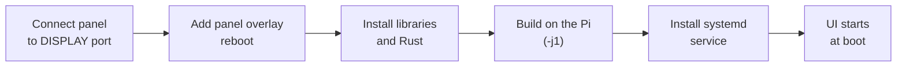
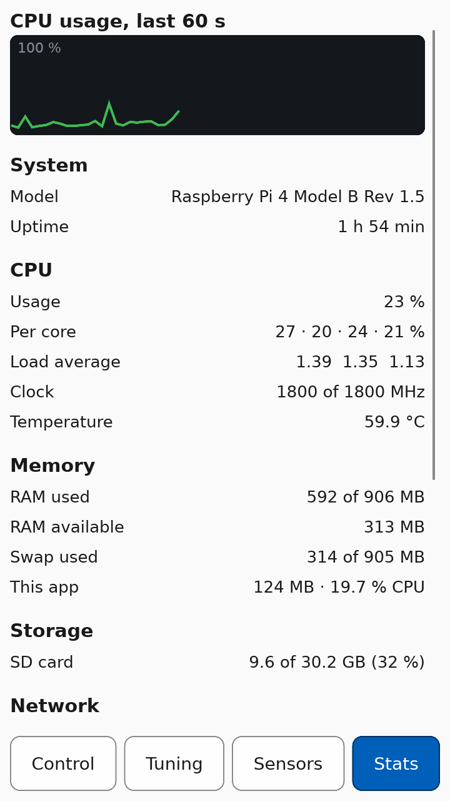

# Raspberry Pi setup

How the Pi in this project was set up, step by step, with what went wrong along the way. Done on 26 November 2026 on
a **Raspberry Pi 4B (1 GB)** running **Debian 13 (trixie) Lite, 64-bit**, kernel 6.18, with the **Raspberry Pi Touch
Display 2** (5 inch, 720 × 1280).



## 1. Display and touch

1. **Cable:** the Pi 4 needs the 15-pin to 22-pin ribbon cable from the panel's box. Plug it into the **DISPLAY**
   connector, between the micro-HDMI ports and the audio jack, **not CAMERA**. The two look the same.
2. **Power:** the panel's red wire goes to 5 V (pin 2), black to GND (pin 6).
3. **Always power off before moving the ribbon cable.** The panel is only detected at boot anyway.
4. **Overlay:** automatic detection did not find the panel on the Pi 4. Add this line at the end of
   `/boot/firmware/config.txt`, under `[all]`, then reboot:

   ```
   dtoverlay=vc4-kms-dsi-ili9881-5inch
   ```

5. **Check:**

   ```sh
   cat /sys/class/drm/card*-DSI-1/status      # connected
   head -1 /sys/class/drm/card*-DSI-1/modes   # 720x1280
   grep Goodix /proc/bus/input/devices        # the touch controller
   ```

Touch works in portrait with no extra settings: touch positions matched the display without rotating or mirroring.

**What the wrong port looks like.** With the cable in CAMERA, the kernel log (`journalctl -k -b`) shows the
following, and no display outputs appear at all, not even HDMI, because the graphics driver waits for the panel:

```
pwm-backlight panel_backlight@1: error -EIO: failed to apply initial PWM state
reg-fixed-voltage 100000002.touch_reg: error -EREMOTEIO: can't get GPIO   (-121)
mipi-dsi fe700000.dsi.0: deferred probe pending: supplier panel_backlight@1 not ready
```

Error -121 means the panel's controller chip never answered on the display's I2C bus.

## 2. Libraries

Slint's screen backend needs Mesa (GBM/EGL), libinput, udev, xkbcommon and fontconfig:

```sh
sudo apt-get install -y build-essential pkg-config libinput-dev libudev-dev libxkbcommon-dev \
    libgbm-dev libdrm-dev libegl-dev libgles-dev libfontconfig-dev libinput-tools
```

The `pidcontroller` user is in the `video`, `render`, `input`, `gpio` and `i2c` groups by default, which covers the
screen, touch and sensors.

## 3. Rust

Installed for the user only, no `sudo` needed:

```sh
curl --proto '=https' --tlsv1.2 -sSf https://sh.rustup.rs | sh -s -- -y --profile minimal
```

## 4. Building on the Pi

```sh
cd ~/PIDproject/pid-rust-demo
cargo build --release --features kms -j1
```

**Use `-j1`**, one compile job at a time. With two jobs, the compiler was killed for running out of memory while
building Slint's compiler crate (1 GB RAM plus 904 MB swap).

| Build | Time on the Pi 4 |
|---|---|
| First build (all of Slint) | tens of minutes; it took several attempts because of the memory problem |
| After changing project code | about 1–1.5 minutes |
| `cargo test --release --features kms -j1` | about 1 minute |

Always pass the same `--release --features kms` to `cargo test`. Different features make cargo rebuild all of Slint.

For larger changes, a faster PC is better. See [§9](#9-building-on-a-windows-pc-planned).

## 5. Running by hand

Stop the service first, because only one program can drive the display and the sensor pins:

```sh
sudo systemctl stop pid-ui
SLINT_BACKEND=linuxkms-femtovg SLINT_SCALE_FACTOR=2 ./target/release/ui
```

- `SLINT_SCALE_FACTOR=2` turns the 720 × 1280 panel into a 360 × 640 working area, so text and controls are finger
  sized.
- The warning `Could not open /dev/tty0: Permission denied` is harmless. It only means the text console cannot be
  switched off; the app draws over it.

## 6. Starting at boot

The service file is in the repository, [`deploy/pid-ui.service`](../deploy/pid-ui.service):

```sh
sudo cp deploy/pid-ui.service /etc/systemd/system/
sudo systemctl daemon-reload
sudo systemctl enable --now pid-ui.service
```

What it does:
- runs `target/release/ui`, the last build, fullscreen at scale factor 2;
- keeps the login prompt off the panel (SSH is unaffected);
- restarts the app 2 seconds after a crash, or if it started before the display was ready;
- after the app stops for any reason, runs `ui --safe-outputs`, which sets the pumps to 0 % and the DAC to 0 V.

| Task | Command |
|---|---|
| Load a new build | `sudo systemctl restart pid-ui` |
| Live log | `journalctl -u pid-ui -f` |
| Free the screen | `sudo systemctl stop pid-ui` |

A broken build keeps restarting; the service does not fall back to an older one.

## 7. Optional: sudo without a password

Done on this Pi for convenience. It means anyone logged in as `pidcontroller` is root without a password, so protect
the account with a strong password or SSH keys.

```sh
echo 'pidcontroller ALL=(ALL) NOPASSWD: ALL' | sudo tee /tmp/010_pidcontroller-nopasswd >/dev/null
sudo visudo -cf /tmp/010_pidcontroller-nopasswd        # check the syntax first
sudo install -m 0440 -o root -g root /tmp/010_pidcontroller-nopasswd /etc/sudoers.d/
sudo rm /tmp/010_pidcontroller-nopasswd
```

To undo: `sudo rm /etc/sudoers.d/010_pidcontroller-nopasswd`.

## 8. Kernel features for the sensors and outputs

**Not added yet.** These go in `/boot/firmware/config.txt` and need a reboot. See [IO-MAP.md](IO-MAP.md) for what
each is for.

```
dtparam=i2c_arm=on                                  # MCP4725 DAC, MPU6050
dtoverlay=dht11,gpiopin=4                           # DHT-22 (kernel driver)
dtoverlay=pwm-2chan,pin=12,func=4,pin2=13,func2=4   # pump PWM; disables the 3.5 mm audio jack
```

To try the DHT-22 driver until the next reboot instead: `sudo dtoverlay dht11 gpiopin=4`.

Do not use `/sys/class/pwm/pwmchip0` for the pumps: on this Pi it is the **touchscreen backlight**.

## 9. Building on a Windows PC (planned)

**Not tried yet.** The plan is to edit and test the UI on Windows directly (`cargo run --bin ui` opens it in a
window), and to cross-compile the Pi version in WSL2:

1. Install WSL2 with **Debian 13 (trixie)**, the same release as the Pi, so the libraries match.
2. In it:

   ```sh
   sudo dpkg --add-architecture arm64 && sudo apt-get update
   sudo apt-get install -y gcc-aarch64-linux-gnu pkg-config libinput-dev:arm64 libudev-dev:arm64 \
       libxkbcommon-dev:arm64 libgbm-dev:arm64 libdrm-dev:arm64 libegl-dev:arm64 libfontconfig-dev:arm64
   rustup target add aarch64-unknown-linux-gnu
   ```

3. Tell Cargo which linker to use, in `.cargo/config.toml`:

   ```toml
   [target.aarch64-unknown-linux-gnu]
   linker = "aarch64-linux-gnu-gcc"
   ```

4. Build, then copy to the Pi. Copy to a new name and rename it over the old one: overwriting the binary while it
   runs fails with "Text file busy".

   ```sh
   PKG_CONFIG_ALLOW_CROSS=1 PKG_CONFIG_PATH=/usr/lib/aarch64-linux-gnu/pkgconfig \
       cargo build --release --features kms --target aarch64-unknown-linux-gnu
   scp target/aarch64-unknown-linux-gnu/release/ui pidcontroller@<pi>:PIDproject/pid-rust-demo/target/release/ui.new
   ssh pidcontroller@<pi> 'cd PIDproject/pid-rust-demo/target/release && mv ui.new ui && sudo systemctl restart pid-ui'
   ```

## 10. Resource use

The **Stats** tab on the touchscreen shows most of these numbers live (see below). These were measured on 26 November
2026, with the app running from the service and showing the Control page: plot redrawn about 30 times per second,
simulated tank, and sensor threads polling sensors that are not wired yet.

| What | Value |
|---|---|
| App CPU | **about 5–8 % of one core** (under 2 % of the whole 4-core CPU), measured per thread over 15 s |
| App memory | **92 MB** resident (PSS), of which **26 MB** is the app's own; the rest is shared libraries and GPU buffers |
| App threads | 8: UI, control loop, 4 sensor threads, stats (parked, 0 % until its tab opens), 1 Slint helper |
| CPU temperature | 53.5 °C, no throttling (`vcgencmd get_throttled` = 0x0), 1.8 GHz |
| System memory | 544 of 905 MB used, but 376 MB of that was the Claude Code development session, which is not part of the deployed system. Without it, about 170 MB is used, so more than 700 MB is free |
| GPU memory split | 76 MB |
| SD card | 8.9 of 29 GB used |

The control loop and sensor threads use almost nothing; nearly all the CPU goes to drawing the plot. The notes'
estimate of 30–60 MB was close for the app's own memory.

Screenshots made with the virtual X display show much higher app CPU (about 20 %). That is software rendering under
Xvfb, not the real panel, which draws with the GPU.

### The Stats tab



| Section | What it shows | Where it comes from |
|---|---|---|
| CPU | Usage over the last 60 s (graph), per core, load average, clock, temperature | `/proc/stat`, `/proc/loadavg`, cpufreq, thermal zone |
| Memory | RAM used and available, swap, this app's memory and CPU | `/proc/meminfo`, `/proc/self/stat`, `/proc/self/smaps_rollup` |
| Storage | SD card used and total | `df` |
| Network | Each interface (Ethernet, Wi-Fi): up or down, speed, Wi-Fi name and signal, IP address, traffic | `/sys/class/net`, `/proc/net/wireless`, `ip`, `iwgetid` |
| Power | Under-voltage, CPU slowed, heat limit (now or since boot), core voltage, supply ratings | `vcgencmd get_throttled`, `vcgencmd measure_volts core` |

It samples once a second, **only while the tab is open**. The rest of the time its thread is parked and uses no CPU.
Values turn amber or red when they need attention: CPU above 80 %, temperature above 70 °C, less than 150 MB RAM
available, SD card above 85 % full, and any under-voltage or throttling.

**Current and power cannot be measured on a Pi 4.** The board has no current or input-voltage sensor, so software
can only tell whether the supply voltage dropped too low (under-voltage) and whether the CPU had to slow down. The tab
shows that, plus the ratings to compare against:
- the official power supply's 5.1 V × 3 A = 15.3 W;
- 1.2 A shared by the four USB ports, a third-party figure rather than an official one.

To measure real current on a Pi 4, put a USB-C power meter between the supply and the Pi. A Pi 5 does report input
voltage and per-rail currents (`vcgencmd pmic_read_adc`). The Stats tab already reads them when present and shows
input voltage and board power, but this is untested because only a Pi 4 was available.

Commands used:

```sh
P=$(systemctl show -p MainPID --value pid-ui)
top -b -H -d 3 -n 2 -p $P                 # CPU per thread
grep -E 'Pss|Private_Dirty' /proc/$P/smaps_rollup
vcgencmd measure_temp; vcgencmd get_throttled; free -m
```

## Troubleshooting

| Symptom | Cause | Fix |
|---|---|---|
| No DSI output, `-121` errors in the kernel log | Cable in CAMERA port, or not seated | Power off, use the DISPLAY port, close both latches |
| Panel not detected even though the cable is right | Auto-detection does not work on the Pi 4 | Add `dtoverlay=vc4-kms-dsi-ili9881-5inch` |
| Build killed, `signal: 9, SIGKILL` | Out of memory | Build with `-j1` |
| `cargo test` rebuilds all of Slint | Different features from the last build | Use `--release --features kms` every time |
| Sensor card says "cannot use GPIO23/24: Device or resource busy" | Another copy of the app holds the pins | `sudo systemctl stop pid-ui` before running by hand |
| DHT-22 card says "kernel driver not loaded" | Overlay missing | See §8 |
